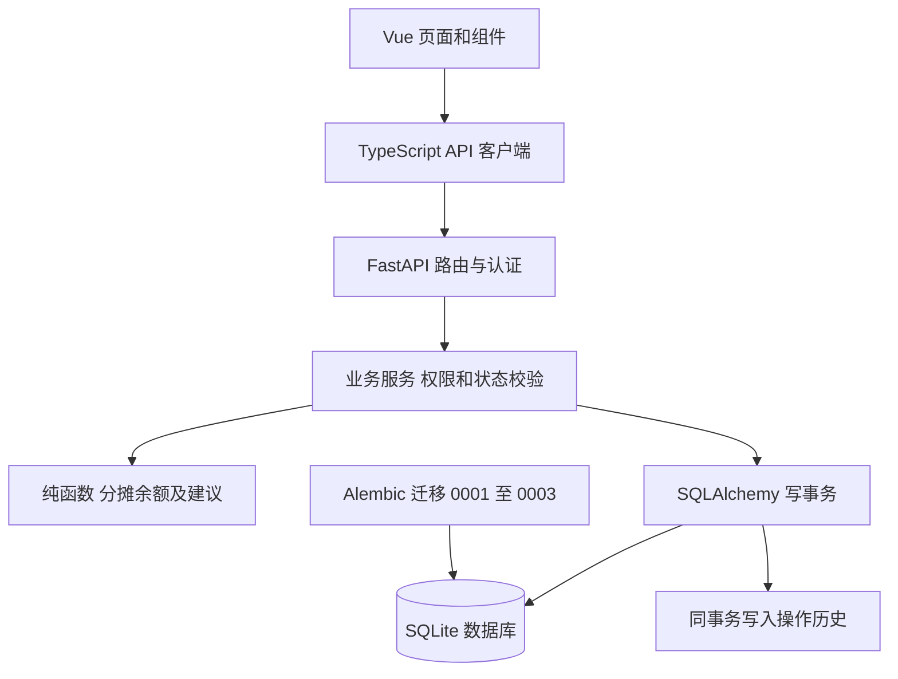
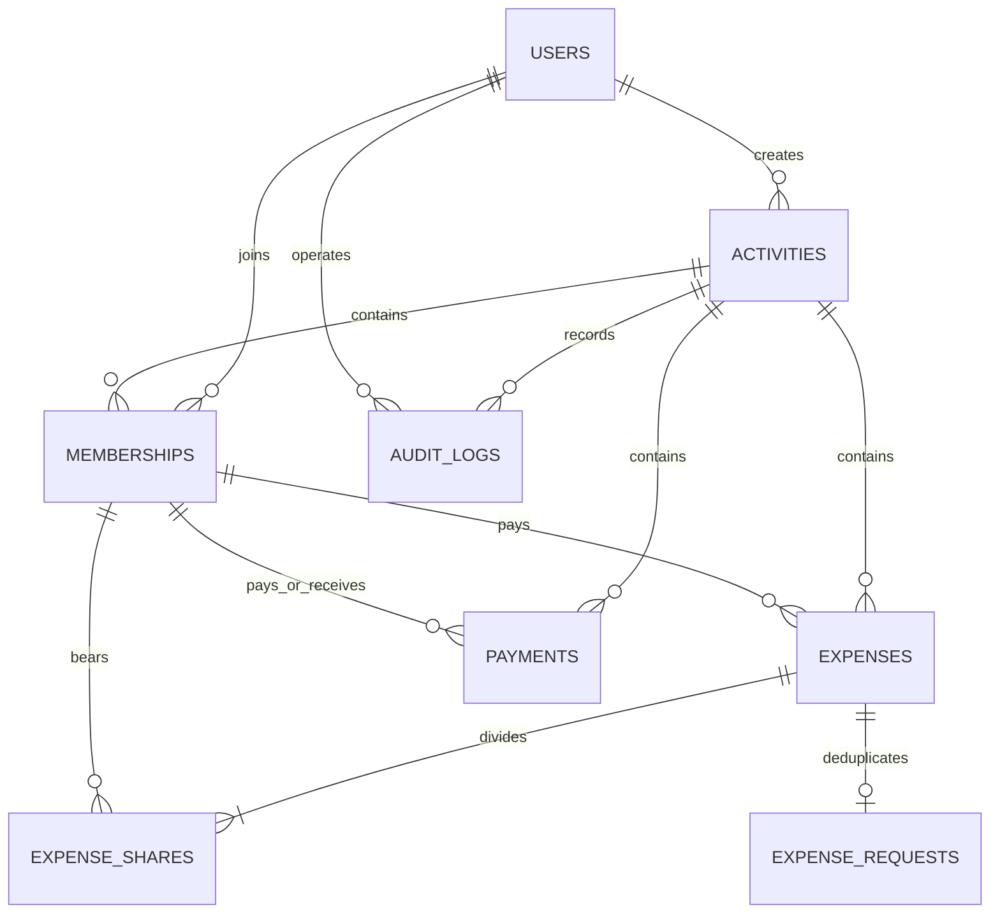
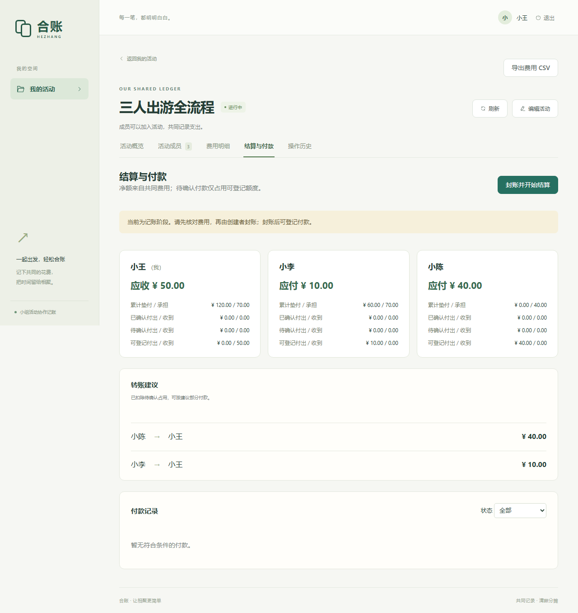
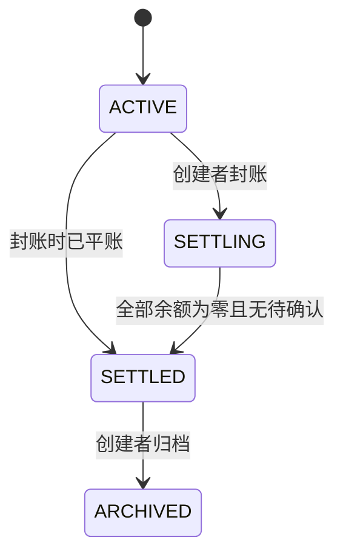
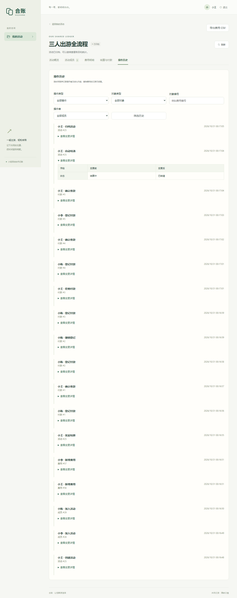

# 合账软件工程课程实验报告

实验题目：面向小组活动的协作记账与费用结算系统的设计与实现。交付版本为课程候选版，整理日期为 2026 年 10 月 31 日。源码与维护记录位于 [Delovue/hezhang](https://github.com/Delovue/hezhang)。

本项目已实现从多人记账到结清归档的完整 Web 流程。FR01–FR12 均有实际页面和后端实现，本地全量自动化测试通过；课堂电脑复现、四名成员独立运行及现场讲解仍需按[演示与验收清单](DEMO_GUIDE.md)完成，因此本报告不将 T20 标记为全部通过。

## 一 选题背景与目标

朋友出游时，不同成员会分别垫付餐费、住宿费和车费，同一笔费用的参与人也可能不同。仅记录“谁付了多少钱”无法说明每个人应承担多少；直接逐笔还钱又会产生较多往来，付款是否收到也难以追溯。

合账将费用与成员间的结算付款分开管理。成员共同维护活动账本，系统按明确规则计算承担和余额，创建者核对账目后封账，付款人登记实际支付，收款人确认，全部结清后归档。这样可以演示需求、业务规则、数据库事务、接口、页面和测试之间的对应关系。

首版采用人民币和整数分，单笔费用只有一个垫付人。系统仅登记线下或其他支付渠道已经完成的转账；不接入真实支付，也不包含多币种、退款、票据上传、成员退出、封账后重新开账和全局最少转账次数优化。

## 二 需求分析

### 使用者与权限

| 使用者 | 可以执行的操作 | 主要约束 |
| --- | --- | --- |
| 未登录用户 | 注册、登录 | 不可读取活动账务 |
| 活动普通成员 | 查看账本、录入费用、修改或删除自己录入的费用、登记自己的付款 | 不能读取其他活动；不能修改别人录入的费用 |
| 活动创建者 | 普通成员能力，编辑活动预算、管理本活动费用、封账和归档 | 无权代替其他收款人确认付款 |
| 付款人或收款人 | 付款人撤销待确认登记；收款人确认或拒绝 | 仅处理对应当事人的待确认记录 |

权限由后端检查。前端隐藏不可执行的按钮用于改善体验，直接调用接口仍受到同样限制。用户 ID 与活动成员 ID 是不同概念；费用分摊、垫付与收付款使用成员 ID，同名成员显示编号以便区分。

### 功能需求与实现

| 需求 | 实现结果 | 主要页面或组件 | 验证入口 |
| --- | --- | --- | --- |
| FR01 认证 | 注册、登录、退出、内存令牌、过期恢复 | AuthView、App、session | activities.spec.ts、test_auth_activity.py |
| FR02 活动 | 创建、修改、名称和状态筛选、分页 | ActivitiesView、ActivityFormDialog | activities.spec.ts、test_activity_queries.py |
| FR03 成员 | 邀请码加入、重复加入保护、成员身份 | ActivityDetailView | activities.spec.ts、test_auth_activity.py |
| FR04 费用 | 增删改查、条件筛选、版本冲突、重试去重 | ExpensePanel、ExpenseEditor | expenses.spec.ts、test_expense_requests.py |
| FR05 分摊 | 均摊、指定金额、按份数、选择部分成员 | ExpenseEditor | expense.test.ts、domain/test_split.py |
| FR06 余额 | 垫付、承担、已确认往来、当前净额 | SettlementPanel | settlement.spec.ts、test_balance_api.py |
| FR07 建议 | 按扣除待确认占用后的额度生成建议 | SettlementPanel | domain/test_settlement.py |
| FR08 付款 | 部分付款、确认、拒绝、撤销、幂等重试 | PaymentDialog、SettlementPanel | settlement.spec.ts、test_settlement_concurrency.py |
| FR09 生命周期 | 封账、自动结清、归档、冻结账目 | SettlementPanel | settlement.spec.ts、test_lifecycle_api.py |
| FR10 历史 | 操作者、时间、前后变化、筛选与游标分页 | AuditPanel | history.spec.ts、test_audit_queries.py |
| FR11 统计 | 预算、超预算、分类与成员承担 | ActivityDetailView | activities.spec.ts、test_reports_api.py |
| FR12 导出 | 登录后下载 UTF-8 BOM CSV，归档后可用 | ExportButton | export.spec.ts、test_reports_api.py |

前端测试位于 [frontend/e2e](../frontend/e2e/) 和 [frontend/tests](../frontend/tests/)；后端测试位于 [backend/tests](../backend/tests/)。

非功能需求包括：金额可精确复现；数据保存在本地文件；失败的写操作整体回滚；并发请求不能超额登记或重复入账；错误有明确说明；代码、依赖锁文件、迁移和运行说明一并交付。当前没有对公网大规模并发或生产运维能力进行验收。

## 三 架构与数据设计

### 分层结构



Vue 3、TypeScript、Vue Router、Pinia 和 Element Plus 负责页面、表单与登录状态。API 客户端统一处理 Bearer、查询编码、字段错误、取消过期账号的响应和文件下载。FastAPI 与 Pydantic 完成接口与输入校验，服务层编排事务和领域规则；纯函数算法可独立测试。SQLite 适合课程演示的单机部署，启用外键、WAL 和有限锁等待。

开发时 Vite 将 `/api` 转发到本机 FastAPI。JWT 只保存在页面内存，页面刷新后重新登录，已保存的数据不受影响。密码使用 Argon2 哈希；密钥从本地配置读取，不提交仓库。当前运行方式面向本地课堂演示，未配置公网生产托管。

### 数据实体关系



| 表 | 关键字段及约束 |
| --- | --- |
| users | username 唯一；保存 password_hash，不保存明文密码 |
| activities | owner_id、预算、邀请码、活动状态 |
| memberships | activity_id 与 user_id 组合唯一；id 是成员 ID |
| expenses | 金额、付款成员、分类、日期、分摊方式、version、is_deleted |
| expense_shares | 同笔费用同成员唯一；复合外键约束费用和成员属于同一活动 |
| expense_requests | 活动、记录者、request_id 组合唯一，保存请求摘要与费用关联 |
| payments | 付款成员、收款成员、金额、状态、request_id；双方不得相同 |
| audit_logs | 操作者、动作、对象、before、after、时间；不记录令牌或密码 |

真实定义见 [models.py](../backend/app/models.py)。迁移 0001 建立基础账本，0002 增加费用请求登记，0003 增加付款表。启动前升级迁移；`/health` 同时检查数据库版本，版本不匹配返回 503。

## 四 核心实现

### 精确金额与分摊

前端以字符串解析金额，用 BigInt 计算整数分，例如 `0.29` 转为 29，避免二进制浮点乘法带来的舍入偏差。后端要求整数分且限制在 JavaScript 安全整数范围内，并在写事务内限制活动有效费用总额不超过 `9007199254740991` 分，使统计、余额和建议都能安全显示并登记付款。

均摊使用商和余数，按成员 ID 升序补足余分。下面是 [split_equal](../backend/app/domain/split.py) 的核心步骤：

```python
base, remainder = divmod(amount_cents, len(ordered))
return {
    member_id: base + (1 if index < remainder else 0)
    for index, member_id in enumerate(ordered)
}
```

因此 10000 分由三人均摊得到 3334、3333、3333。指定金额要求非负且总和严格等于费用金额；按份数先用整数除法分配，再按余数降序、成员 ID 升序补足。三种方式都满足“分摊总和等于费用总额”。预览与保存调用同一个后端分摊入口，前端不维护第二份计算算法。

### 余额和建议

```text
余额 = 累计垫付 − 累计承担 + 已确认付出 − 已确认收到
可登记付出 = max(−余额, 0) − 待确认付出
可登记收到 = max( 余额, 0) − 待确认收到
```

正余额表示应收，负余额表示应付。余额从有效费用和付款流水汇总，不另外保存一个容易失配的余额字段。转账建议每轮匹配额度最大的债务人与债权人，转移两者的较小额度；同额度按成员 ID 排序，结果可复现。建议只是一份计算结果，不会登记付款，也不保证全局最少转账次数。

例如 A 垫付 120 元餐费由三人均摊，B 垫付 60 元车费仅 A、B 分摊，余额为 A 应收 50、B 应付 10、C 应付 40。C 登记 20 元后余额仍为 50／10／40，但双方可登记额度减少；A 确认后才变为 30／10／20。付款始终不计入活动消费总额。



### 状态与并发



付款状态从 PENDING 进入 CONFIRMED、REJECTED 或 CANCELLED，后三者为终态。仅收款人确认或拒绝，付款人可以撤销自己的待确认记录。确认后重新汇总并判断是否结清；创建者也不能绕过收款人权限。

写请求先通过 `BEGIN IMMEDIATE` 取得 SQLite 写锁，再读取活动、版本和额度，防止两个请求同时依据旧额度通过校验。费用、分摊、付款与历史写入在同一事务中完成；审计失败也会使业务写入回滚。费用编辑要求提交当前 version，旧版本返回 409，不覆盖他人修改。

费用创建和付款登记使用 UUID v4 请求编号。网络错误或响应正文不完整时，页面保留原内容及编号，重试仍是同一请求；后端校验请求内容，保证不会重复记账。编辑遇到版本冲突时保留草稿，用户加载最新记录、核对后才能再次保存。

### 历史与导出

历史按编号倒序分页，后续页面使用 `before_id`，避免浏览期间新增记录使旧页重复或漏读。页面将金额、成员、状态和分摊翻译为可读内容，展示变化前后值；删除费用仍保留审计记录。CSV 通过带登录令牌的请求下载，包含日期、分类、费用说明、垫付人、总额、分摊方式和成员承担列；UTF-8 BOM 支持中文，危险的公式前缀经过转义。



## 五 功能到代码的答辩定位

| 要解释的功能 | 前端入口 | 后端关键实现 |
| --- | --- | --- |
| 登录与会话恢复 | [session.ts](../frontend/src/stores/session.ts)、[App.vue](../frontend/src/App.vue) | [auth.py](../backend/app/api/auth.py)、[security.py](../backend/app/security.py) |
| 录入、编辑、删除费用 | [ExpenseEditor.vue](../frontend/src/components/ExpenseEditor.vue)、[ExpensePanel.vue](../frontend/src/components/ExpensePanel.vue) | [expense.py](../backend/app/services/expense.py)：create_expense、update_expense、delete_expense |
| 三种分摊与余数 | [expense.ts](../frontend/src/utils/expense.ts) 只校验输入 | [split.py](../backend/app/domain/split.py)：calculate_split、compute_split、split_equal、split_exact、split_shares |
| 应收应付与建议 | [SettlementPanel.vue](../frontend/src/components/SettlementPanel.vue) | [balance.py](../backend/app/domain/balance.py)：compute_balances；[settlement.py](../backend/app/domain/settlement.py)：suggest_transfers |
| 部分付款和确认 | [PaymentDialog.vue](../frontend/src/components/PaymentDialog.vue) | [payment.py](../backend/app/services/payment.py)：create_payment、change_payment |
| 封账和归档 | SettlementPanel 的 lifecycle | [lifecycle.py](../backend/app/services/lifecycle.py)：start_settlement、settle_if_cleared、archive_activity |
| 事务与并发 | 请求冲突提示 | [database.py](../backend/app/database.py)：transaction、begin_sqlite；[dependencies.py](../backend/app/api/dependencies.py)：get_session |
| 历史和 CSV | [AuditPanel.vue](../frontend/src/components/AuditPanel.vue)、[ExportButton.vue](../frontend/src/components/ExportButton.vue) | [audit.py](../backend/app/services/audit.py)、[export.py](../backend/app/services/export.py) |

答辩时先打开页面对应组件，找到调用的 API 方法，再进入路由、服务和领域函数。说明输入、权限、状态条件、事务边界及失败处理，最后展示对应测试。不要只背诵函数名。

## 六 测试与结果

2026 年 10 月 30 日至 31 日，在 Windows、Python 3.12.16、Node.js 24.18.0、npm 11.16.0 和 Chromium 下执行：后端 333 项通过、前端单元测试 59 项通过、浏览器测试 17 项通过，无失败或跳过。后端 app 语句覆盖 1344／1359 行，约 98.90%；覆盖率不等同于所有输入和并发交错均已证明正确。

浏览器用例使用独立临时数据库和不同账号会话，实际执行记账、分摊、部分付款、收款确认、拒绝、撤销、归档、历史和导出。另有 18 项真实 HTTP 检查与服务进程重启后的 3 项持久化检查。全新源码目录重新安装锁定依赖后，构建、三人浏览器全流程与重启检查再次通过。Ubuntu 24.04 的 GitHub Actions 同时验证后端和前端。

详细命令、T01–T20 对应关系、缺陷修复、CI 链接与尚未完成的人工验收见 [系统验收与测试报告](ACCEPTANCE_REPORT.md)，逐用例结果见 [local-results.json](verification/local-results.json)。

## 七 开发过程与分工

原计划按甲负责前端、乙负责基础后端与权限、丙负责账务算法与结算、丁负责测试和交付组织。角色代号表示职责，不能替代真实成员身份或贡献证明；个人贡献以 GitHub 实际提交、PR 和本人答辩为准。

基础后端、结算后端和前端第一阶段通过 PR 分步合并。本轮以独立功能为边界，验证后立即提交推送：费用模块 `6269fc0`，结算模块 `b10512c`，CSV 与请求处理 `d6a0d60`，审计历史 `3fd86a6`，演示工具 `343f288`，系统回归配置 `878c803`。此外修复了筛选分页、同名成员和测试依赖漏洞。未通过的开发期测试经定位后修复或纠正契约断言，未将失败结果写成通过。

## 八 总结与限制

本项目把“记账”扩展为可核对、可追溯的协作流程。主要工程成果是整数金额守恒、费用与付款分离、明确的权限及状态机、事务内去重与额度保护，以及功能到测试和源码的可追踪关系。

当前可以在本地运行并完成演示，依赖安装后日常操作无需外部服务。首版未提供生产部署、密码找回、真实支付或高并发容量保证。课程最终验收还应在实际课堂电脑完成安装与三人流程，确认投影可读、3–5 分钟演示节奏及四名成员对代码的理解。完成这些人工项目后再建立正式课程发布标签。

[运行与演示说明](DEMO_GUIDE.md) · [系统验收记录](ACCEPTANCE_REPORT.md) · [开发计划](DEVELOPMENT_PLAN.md)
